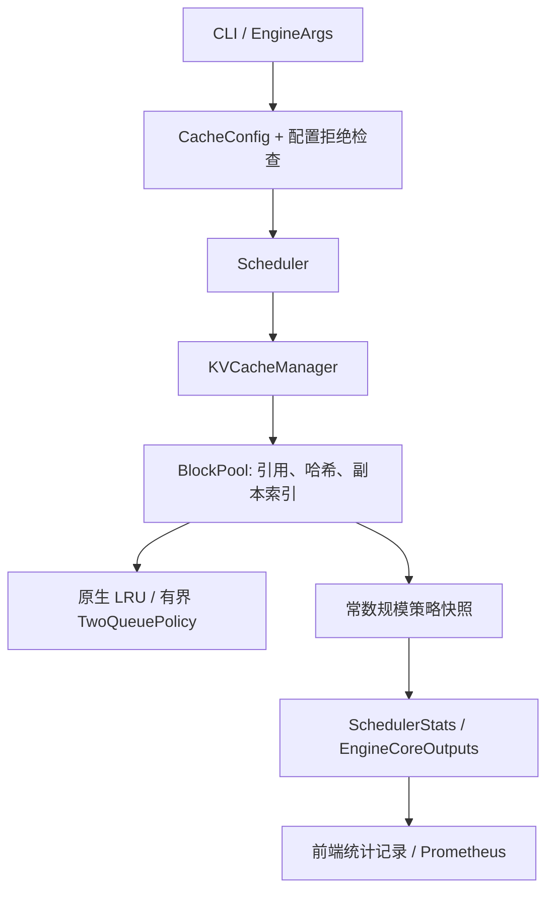

# AgentCache：让热点前缀抵抗一次性请求冲刷

Agent 多轮调用常常重复很长的系统上下文，但一次性长请求可能挤掉这些可复用的 KV。AgentCache 为 vLLM 的原生缓存池增加**有界 Two-Queue 淘汰策略**：优先复用冷区空闲块，为命中过的前缀提供有限保护，并在资源紧张时允许降级和回退。

你可以在这里阅读真实引擎改动、运行无需 GPU 的检查、重建固定版本源码，或在兼容 Linux 环境中复现四种工作负载。项目同时保留开销和负结果，**不以“必须提速”作为完成条件**。

- 原生配置接入：CLI 参数最终传入真实 BlockPool，不使用运行时 monkeypatch。
- 安全生命周期：策略管理优先级；原生池仍管理引用、哈希及重复副本。
- 可观测性：冷热空闲、保护额度、晋升、降级和淘汰指标沿现有统计链导出。
- 已有验收：两份 Linux 原生测试文件 48 项、15,000 个 CPU 状态比较、334 对串行输出，以及并发/断连/抢占恢复记录。
- 结果边界：7B 的合成扫描场景保留热点；共享热点、切换和纯冷场景不保证提速。

> 这是一个**引擎源码扩展项目**，不是新模型、完整 Agent 平台或从零实现的推理引擎。本仓库采用源码覆盖层交付，不能直接 `pip install .`。固定运行基线为 vLLM 0.8.3 V1；不宣称兼容最新版。

[中文项目 PDF](docs/AgentCache-Project-Report.pdf) · [架构与源码](docs/ARCHITECTURE.md) · [复现说明](docs/REPRODUCIBILITY.md) · [完整结果](docs/RESULTS.md) · [真实迭代过程](docs/ITERATION_HISTORY.md) · [演示与答辩](docs/DEMO.md)

## 1. 项目解决什么问题

KV Cache 保存模型已处理 token 的 Key/Value。APC（自动前缀缓存）进一步允许不同请求复用相同 token 前缀的完整块，减少重复 prefill；它不是返回旧答案，也不是语义相似度缓存。

LRU 依据块的使用顺序选择空闲块。连续的一次性长上下文请求会让原热点逐渐成为较早的空闲候选；热点回来时可能需要重新计算。Two-Queue 将“刚使用过”和“已经表现出复用价值”分开，以有界保护降低扫描污染。

注意：本项目改变的是**空闲块的分配/淘汰优先级**，没有修改 FlashAttention kernel、PagedAttention 的 GPU 算子或模型权重，也没有增加显存中的物理块容量。

## 2. 架构与运行流程



配置声明不等于运行证明。EngineCore 启动记录 `AGENTCACHE_NATIVE_ENGINE`，包含实际策略、队列类型、配置及核心源码哈希；采集器据此检查运行身份。

| 核心位置（相对重建后的源码树） | 职责 |
|---|---|
| `vllm/engine/arg_utils.py`、`vllm/config.py` | 参数声明、传递及不支持配置拒绝 |
| `vllm/v1/core/sched/scheduler.py` | 配置下传、调度统计、请求生命周期 |
| `vllm/v1/core/kv_cache_manager.py` | 请求需要的块、前缀命中及分配 |
| `vllm/v1/core/block_pool.py` | 引用、哈希、多副本、分配、释放、reset |
| `vllm/v1/core/gpu_eviction_policy.py` | 冷热队列、有界保护、晋升/降级和回退 |
| `vllm/v1/metrics/{stats,loggers}.py` | 统计快照和 Counter 增量导出 |

本仓库中的对应文件位于 [overlay/](overlay/)。只分发一份项目覆盖层；完整上游树在本地 `build/` 中按固定 SHA256 重建，不重复提交。

## 3. 策略与安全约束

原生参数：

| 参数 | 默认值 | 含义 |
|---|---|---|
| `--gpu-eviction-policy` | `lru` | `lru` 或 `two_queue` |
| `--gpu-cache-protected-ratio` | `0.5` | Two-Queue 保护比例，必须有限且处于 `(0,1]` |

默认 LRU 保持原空闲队列和分配顺序，不维护 Two-Queue 的保护表；仍存在观测和条件分支，不能宣称绝对零开销。

Two-Queue 的主要规则：

1. 新块优先从冷区空闲队列分配；冷区耗尽才回退到热区。
2. 前缀查找本身不增加引用；`touch` 先移除空闲候选并增加引用，再调用 `promote`。
3. 保护集合可以包含活动块。保护超额时降级最旧保护，**不改变引用数，也不立即删除 KV**。
4. 请求结束只减少自己持有的引用；最后一个引用释放后，普通块才进入冷热空闲队列。
5. 真正重用块时，原生池删除该物理副本的旧哈希索引；同哈希的其它副本仍可保留。
6. 有活动引用时 reset 拒绝且状态不变；成功 reset 清理哈希/保护，累计计数不归零。

保护额度为 `max(1, int((总块数 - 1) * ratio))`，扣除编号 0 的 null block。256 blocks 对应 255 个普通块、保护额度 127；1024 blocks 对应 1023 个普通块、额度 511。

单块队列/字典维护和指标快照不扫描全池；一个请求涉及 k 个块时，处理仍是 O(k)。reset 与调试遍历可扫描池。该策略不是 ARC，没有 ghost history 或动态自适应额度。

### 支持范围

Two-Queue 首版仅支持 V1、CUDA、单 GPU、TP/PP/DP=1、单非 MLA FullAttention 缓存组、纯文本生成且 APC 开启。
滑窗、混合缓存组、LoRA、prompt adapter、推测解码和 KV transfer 等不支持配置会明确拒绝，不静默回退。默认 LRU 沿用上游功能边界。

## 4. 最小运行：不需要 GPU 或模型

环境：Python 3.11+，只使用标准库。以下命令在 **Windows PowerShell 或 Linux 项目根目录**均可执行：

```text
git clone https://github.com/lingjiekong04/agentcache-vllm.git
cd agentcache-vllm
python -S -B tools/check_release.py
python -S -B tests/test_release_tools.py
```

这检查公开文件清单、来源映射、结果算术和发布工具约束；**不证明真实服务或 GPU 性能**。

### 运行原生定义抽取检查

先获取固定官方基线。下载由使用者显式执行；若网络失败，保留失败文件并暂停，不换镜像或版本。

**Windows PowerShell：**

```powershell
New-Item -ItemType Directory -Path reports -Force | Out-Null
if (Test-Path reports/baseline.tar.gz) { throw '基线文件已存在，暂停，不覆盖' }
curl.exe --fail --location --max-time 120 `
  'https://codeload.github.com/vllm-project/vllm/tar.gz/refs/tags/v0.8.3' `
  --output reports/baseline.tar.gz
if ($LASTEXITCODE -ne 0) { throw '下载失败，暂停' }
python -S -B tools/run_checks.py --archive reports/baseline.tar.gz --output reports/cpu-r1
```

**Linux 终端：**

```bash
mkdir -p reports
test ! -e reports/baseline.tar.gz && \
curl --fail --location --max-time 120 \
  https://codeload.github.com/vllm-project/vllm/tar.gz/refs/tags/v0.8.3 \
  --output reports/baseline.tar.gz && \
python3 -S -B tools/run_checks.py \
  --archive reports/baseline.tar.gz --output reports/cpu-r1
```

也可以直接使用已有的官方基线包，不必重新下载。工具强制校验：

```text
99078eb047a302bcf553aa3c84230631cd4b1288927c326a8be9c714b08faffb
```

工具会安全重建 `build/vllm-0.8.3/`，执行工具测试及 7 项抽取合约、15,000 个状态比较。输出目录已存在时拒绝覆盖。抽取执行不是完整 vLLM 导入、Linux 原生 pytest 或 GPU 验收。

## 5. Linux 原生服务复现

GPU 复现只在使用者明确选择后执行。**本次公开整理没有启动模型、重新下载权重或重新跑 GPU。**

需要预先准备兼容的 Linux Python 3.11、已安装的 vLLM 0.8.3 及同版本 CUDA 扩展、模型缓存和隔离 pytest。上游依赖含 Torch 2.6.0 等要求，但本仓库没有完整的历史 wheel 哈希锁，因此不提供“任意新机器一键精确复现”承诺。

完成基线重建后，在 **Linux 项目根目录**设置自己的解释器和只读模型缓存：

```bash
export AGENTCACHE_PYTHON=/absolute/path/to/existing-v083-env/bin/python
export AGENTCACHE_HF_HOME=/absolute/path/to/existing/huggingface-cache
source tools/env.sh
cd "$AGENTCACHE_PROJECT"
"$AGENTCACHE_PYTHON" -u agentcache/prepare_runtime.py
"$AGENTCACHE_PYTHON" -u agentcache/prepare_runtime.py --verify
```

`prepare_runtime.py` 只向新建源码树复制同版本扩展并验证实际导入路径，不改旧 site-packages。它还检查原安装核心哈希；不符合时应暂停，而不是绕过校验。准备失败的部分文件保留，不自动清理或覆盖。

完整双终端启动、输入固化、采集、正常停止和配对命令见 [复现说明](docs/REPRODUCIBILITY.md)。建议先做 0.5B 快速回归，再考虑 7B。每个场景/策略从全新服务开始，共用同一输入 manifest。

## 6. 固定工作负载与实验设置

| 场景 | 请求数/单策略 | 目的 |
|---|---:|---|
| 多会话多轮 `agent_sessions` | 17 | 共享长上下文的固定轨迹 |
| 扫描后返回 `scan_return` | 75 | 热点预热、一次性冷扫描、返回探测 |
| 工作集切换 `working_set_shift` | 30 | 新热点接纳、配额降级和旧热点返回 |
| 纯冷 `cold_only` | 45 | 无命中负对照，观察维护成本 |

每个场景包含 5 个引擎预热请求。每模型单策略合计 167 个请求，两个模型两策略合计 668 个串行请求、334 对比较。
工具结果是预录制文本，不执行外部命令；后续请求不根据随机生成结果变化。它是推理轨迹演示，不是完整工具调用平台。

| 配置 | 快速回归 | 最终演示 |
|---|---|---|
| 模型 | Qwen2.5-0.5B-Instruct | Qwen2.5-7B-Instruct |
| 上下文 / 总块数 | 2048 / 256 | 8192 / 1024 |
| 数据类型 / block size | BF16 / 16 | BF16 / 16 |
| 保护比例 / seed | 0.5 / 0 | 0.5 / 0 |
| 显存预算 | 0.2 | 0.2 |
| 运行请求上限 | 串行 1；生命周期 4 | 串行 1；生命周期 4 |

历史验收硬件为 A100-SXM4-80GB、驱动 550.54.14。7B 生命周期与串行实验来自不同 GPU 批次；各自内部配对，不跨批次合并时延。完整请求日志关闭，保留访问和周期统计。

## 7. 结果：局部收益与负结果一起保留

以下是历史单次配对的阶段 mean，单位为**非流式 HTTP 完整响应毫秒**。不是 TTFT；HTTP 服务时间倒数也不等于含客户端间隔的 wall-clock 吞吐。

| 7B 场景/阶段 | LRU mean ms | Two-Queue mean ms | 缓存命中情况 |
|---|---:|---:|---|
| 扫描前 | 19.466 | 20.165 | 两版均 99.48% |
| 冷扫描 | 261.841 | 262.170 | 两版均 0% |
| 扫描后热点返回 | 198.934 | 19.666 | LRU 0%；Two-Queue 99.48% |
| 多会话多轮 | 409.660 | 407.741 | 两版均 90.72% |
| 切换后的新热点 | 80.516 | 78.271 | 两版均 66.32%，含首次冷请求 |
| 旧热点返回 | 200.891 | 195.238 | 两版均 0% |
| 纯冷负对照 | 262.703 | 263.457 | 两版均 0% |

在扫描后 5 次探测上，HTTP mean 约降低 90.1%；这仅描述该构造中的热点保留效果，不是生产总体提速或统计显著性结论。

0.5B 的多轮 mean 为 137.430 / 152.717 ms，纯冷为 12.627 / 14.936 ms，Two-Queue 更慢；热点切换也有较慢阶段。0.5B 冷扫描阶段两版均未命中却有明显延迟差，不能把所有差异归因于缓存保护。

详细 p50/p95、命中次数和请求数见 [完整结果](docs/RESULTS.md)、[机器可读结果](evidence/results.json) 和 [CSV](evidence/stage-results.csv)。

### 验证分层

| 层次 | 已有证据 | 不代表什么 |
|---|---|---|
| 标准库 / 抽取定义 | 7 项合约、15,000 状态；工具和配置测试 | 不是真实 GPU 推理 |
| Linux 原生 | 两份 prefix/scheduler 文件 48/48，含新增 9 项 | 不是上游全部测试 |
| 真实服务 | 16 次串行服务、334 对输出一致 | 不证明所有输入和模型质量 |
| 生命周期 | 4 次服务、84 完整响应、4 流式断连；每次 2 次抢占 | 不穷尽内部 KV 数值或全部竞态 |
| 本次公开整理 | 原证据重新离线审核、来源哈希、重建/工具检查 | 不是新一轮 GPU 成绩 |

本次独立离线审核的原证据 SHA256：`4f74650c8659bb41914c65a734ec3468b6608b2a7f7f3318374b5d939672276e`。
公版只发布聚合字段与来源哈希，不附原始请求、服务日志、主机名或 GPU UUID；没有原证据包时，公众不能仅凭摘要重审每个请求，这个缺口明确保留。

## 8. 真实迭代：组件分别说明

| 组件/记录 | 相比前一步改变了什么 | 解决问题与验证 | 最终采用？ |
|---|---|---|---|
| 实验策略 v1 → 冻结 v2 | 固化有界保护与空闲块生命周期参考行为 | 原生移植后做 15,000 状态差分；不以跨测试成绩拼提升曲线 | v2 作为参考；实验启动器不参与工程运行 |
| 冻结 v2 → 原生 Two-Queue | 加入配置链、原生池 hooks、指标和运行身份 | 核对真实 EngineCore 与服务记录 | 是；不是新自适应算法 |
| 配置修复 r1 | 补齐 Two-Queue 测试设备配置，并显式拒绝缺失配置 | 首轮 2 失败保留；新增用例后两文件 48 通过 | 是；正确性修复，不是提速版本 |
| spawn 检查 v2 | 加进度、可配置等待和失败保存 | 处理慢导入导致的检查超时 | 工具采用；旧 spawn 不冒充修复后 GPU 验收 |
| 本次公版覆盖层 | 分离私有记录、重建工具、文档和 PDF | 来源映射和公开文件清单检查 | 作为交付形式；核心 10 文件不变 |

模型没有训练版/微调适配器迭代；没有自建训练数据集或真实工具后端升级。输入 manifest 是固定工作负载，不是训练数据。历史压缩包的 r1/r2/r3 修订不等于算法升级。更完整的分组件记录见 [ITERATION_HISTORY.md](docs/ITERATION_HISTORY.md)。

## 9. 目录和资源

```text
overlay/                 原生核心、测试和必要工具的精确覆盖层
patches/                 相对固定上游的核心/测试补丁
tools/                   重建、公开完整性检查、CPU 检查和环境设置
tests/                   公版打包工具合约
evidence/                聚合结果、历史验收摘要、被验收源清单
upstream/                官方基线 URL / SHA256 与许可证
docs/                    架构、复现、结果、迭代、演示、范围和 PDF
SOURCE_MAP.json          公版复制文件到远程审查成员的映射及哈希
PUBLIC_MANIFEST.json     公版文件完整性；包含 README、文档和 PDF
build/、reports/         本地生成，不上传 GitHub
```

模型资源不随仓库发布：

- [Qwen2.5-0.5B-Instruct](https://huggingface.co/Qwen/Qwen2.5-0.5B-Instruct)：历史记录未完整绑定固定 revision / 权重 SHA256，不能声称字节级复现。
- [Qwen2.5-7B-Instruct 固定 revision](https://huggingface.co/Qwen/Qwen2.5-7B-Instruct/tree/a09a35458c702b33eeacc393d103063234e8bc28)：下载记录为 4 分片、15,231,271,888 字节；没有绑定每次服务的全部分片 SHA256。

不发布模型权重、CUDA 扩展、优化器状态、缓存、历史完整执行包或真实用户数据。模型许可和访问条件以模型提供方相应版本为准，本仓库代码许可不替代模型许可。

## 10. 限制、归属与开源说明

- `performance_conclusions_allowed=false` 保持不变；没有稳定整体提速结论。
- 未验证最新版迁移、多 GPU、混合缓存、完整生产高可用、上游全套或全部并发竞态。
- 首次调度快照前策略 Gauge 为零占位；初始额度以 EngineCore 身份为准。
- 旧服务日志不完整记录正常关闭；不能声称所有停止过程均有日志证明。
- 此次重建和包装检查不能替代新机器原生/GPU 验收；新公版清单不冒充原验收清单。
- vLLM 引擎与原生生命周期来自上游；新增工作是策略接入、生命周期 hooks、指标、测试、工作负载与证据工程。
- AI 辅助代码与文档整理；维护者应亲自审阅核心代码、完成个人理解与授权确认，不声称从零独立编写全部引擎。

代码分发采用 [Apache-2.0](LICENSE)，保留原始 SPDX/上游许可；第三方来源与分发范围见 [THIRD_PARTY_NOTICES.md](THIRD_PARTY_NOTICES.md)。这是非官方扩展，没有创建或合并上游 PR。

[上传与剩余缺口](docs/RELEASE_SCOPE.md) · [手动发布命令](docs/PUBLISH.md)
